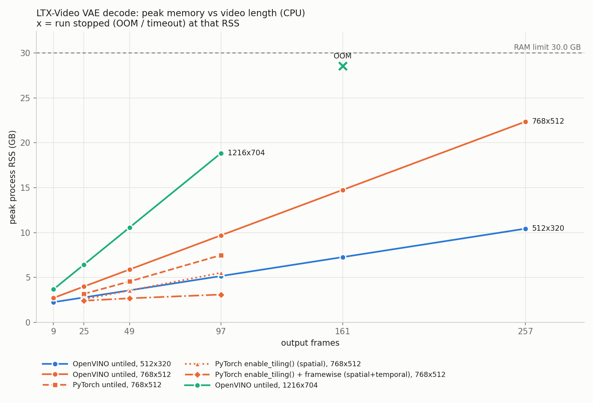

# LongVid-OV

Long video generation on an Intel CPU without running out of memory.

LTX-Video makes a video in a small latent space. At the end a VAE decoder turns the latents into frames.
In OpenVINO GenAI this decoder runs on the whole video in one call, so memory grows with every frame.
On a 4 vCPU Intel Xeon with 30 GB RAM, a 257-frame video at 768x512 needs 22.4 GB just for the decode.
At 1216x704 even 161 frames do not fit.

I added temporal tiling to the decoder. It decodes the video in short overlapping chunks and cross-fades them.
Memory stays flat no matter how long the video is.

## Results

All numbers are measured on Kaggle, Intel Xeon @ 2.20 GHz, 4 vCPU, 30 GB RAM. Single runs.
Memory (peak RSS) is the main result. Times are a rough guide. Every number is in [`docs/RESULTS.md`](docs/RESULTS.md) with its source file.

| | untiled | temporal tiled |
|---|---|---|
| 512x320, 257 frames | 10.4 GB | 2.6 GB |
| 512x320, 1,025 frames (41 s of video) | not run | **2.6 GB** |
| 768x512, 161 frames | 14.7 GB | 4.2 GB |
| 1216x704, 161 frames | out of memory at 28.6 GB | |
| 769 generated frames (31 s), full INT8 pipeline | 27.3 GB | **4.0 GB** |
| 1,537 generated frames (62 s) | out of memory | still at 4.8 GB when the 1 h limit hit |



- **Memory is flat.** At 512x320 memory goes up only 12 MB from 257 to 1,025 frames.
- **Quality.** Tiled vs untiled decode of the same latents is 42.6 to 48.0 dB PSNR, depending on size and chunk.
- **Cost.** Tiling is slower. The default chunk (16 latent frames, overlap 8) takes 2.03x the untiled time.
  Chunk 32 with overlap 8 takes 1.29x the time with 0.53x the memory and 47.98 dB.
- **C++ in OpenVINO GenAI.** Same tiling in `AutoencoderKLLTXVideo`, off by default. 12 new tests pass.
  The C++ output is bit-identical to my Python reference at 49 and 97 frames. At 97 frames memory goes from 4.9 GB to 2.6 GB.
- **A bug in diffusers.** Its temporal tiled decode drops the wrong frame, so every frame after the first chunk is one frame late.
  Tiled vs untiled is 30.50 dB on the same frame and 36.85 dB on the previous frame. A one-line fix gives 41.64 dB.
- **Static shapes.** Reshaping the decoder IR to a static shape saves 1.19 GB at 768x512, 49 frames. That brings OpenVINO within about 0.1 GB of PyTorch.
- **FP16 weights** save about 0.44 GB with no quality loss (86 dB vs FP32).
  Full INT8 (weights and activations) saves 46% memory and runs 1.5x faster, but quality drops to 37 dB, so I count it as a failed experiment.
- **Full pipeline in INT8.** The whole LTX-Video model in INT8 OpenVINO is 6.64 GB and loads in OpenVINO GenAI in 13 s.
  I chained 8 windows (Text2Video, then Image2Video from the last frame) into 385 frames, 15.4 s at 25 fps, with an 18.1 GB peak.

## Upstream

- OpenVINO GenAI issue: [openvinotoolkit/openvino.genai#4906](https://github.com/openvinotoolkit/openvino.genai/issues/4906)
- OpenVINO GenAI draft PR (C++ tiling, tests, Python API): [openvinotoolkit/openvino.genai#4907](https://github.com/openvinotoolkit/openvino.genai/pull/4907)
- diffusers bug report: [huggingface/diffusers#15282](https://github.com/huggingface/diffusers/issues/15282)
- INT8 OpenVINO model: [rahmanbazarov/LTX-Video-int8-ov](https://huggingface.co/rahmanbazarov/LTX-Video-int8-ov)

## How the tiling works

The LTX-Video VAE compresses time 8x. Latent frame 0 becomes video frame 0, latent frame k becomes video frames 8k-7 to 8k.
A chunk of latent frames is decoded on its own. Its first latent frame only makes one video frame, and the previous chunk already made that frame.
So for every chunk after the first I drop the first decoded frame (diffusers drops the last one, which is the bug).
Neighbour chunks overlap, and the overlap is blended with a linear cross-fade.
Finished frames can be streamed out as uint8, so the float32 video never has to sit in RAM.

Code: [`src/longvid_ov/tiled_decode.py`](src/longvid_ov/tiled_decode.py). C++ patch: [`patches/0001-ltx-temporal-vae-tiling.patch`](patches/0001-ltx-temporal-vae-tiling.patch).

## Repo layout

| path | what |
|---|---|
| `src/longvid_ov/` | Tiled decoder (temporal, spatial, both), metrics, benchmark workers |
| `tests/` | Unit tests with a toy decoder and a tiny random VAE |
| `patches/` | The C++ change for OpenVINO GenAI (on commit `1e573f4`) |
| `scripts/` | Step 1 conversion check, environment check, helpers that pack the code into one-file Kaggle scripts |
| `kaggle/` | One script per Kaggle run (memory benchmark, tiling benchmark, full INT8 pipeline, GenAI build and tests, tuning) |
| `results/` | Reports, CSV and JSON for every run |
| `docs/RESULTS.md` | All final tables with the source file of each number |

## Run it

```bash
pip install -r requirements.txt
pytest tests
python scripts/s1_vae_convert_check.py   # converts the LTX-Video VAE to OpenVINO and compares it with PyTorch
```

The Kaggle scripts are self-contained. Each one installs what it needs and writes a report into its output folder.
The big runs need about 30 GB of RAM and several hours on 4 vCPUs.

## Limits

- CPU only. No GPU or NPU runs.
- Single runs, so times can move by a few percent.
- Some memory curves use random latents scaled to the real latent mean and std. Quality numbers always use real latents.
- The long video drifts. Sharpness falls to about half by window 5. Tiling does not fix that, it only fixes the decode memory.

## License

Code is Apache 2.0. The LTX-Video model is under the [LTX-Video Open Weights License](https://huggingface.co/Lightricks/LTX-Video).
