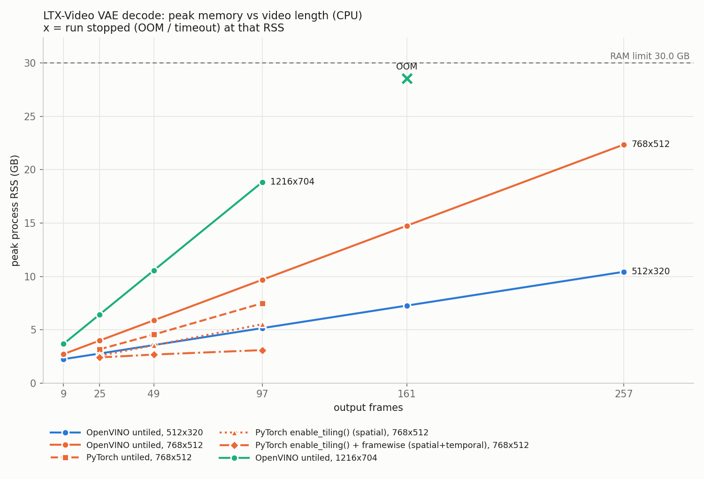

# Step 2 report: LTX-Video VAE decode memory vs video length

Generated by `s2_memory_bench.py` on 2026-11-12 04:32:03; total runtime 128.1 min. Every number below was measured in this run (raw: `s2_results.csv/json`).

## Setup
- Machine: Intel(R) Xeon(R) CPU @ 2.20GHz, 4 logical CPUs, RAM limit 30.0 GB, swap 0.0 GB. Full details: `s2_env.txt`.
- Versions: python 3.13.18, openvino 2026.4.1, openvino-genai 2026.4.1.0, torch 2.11.0+cpu, diffusers 0.39.0, numpy 2.1.3, psutil 5.9.5, pandas 2.3.3, matplotlib 3.10.0.
- Model: `Lightricks/LTX-Video` `vae/` only, decoder converted to OpenVINO IR (FP32, dynamic frames/H/W), native Conv3d.
- Conversion: 29.11 s, peak RSS 1.77 GB, IR weights 0.89 GB, signature `[1,128,?,?,?]` -> `[1,3,1..,1..,11..]`.
- IR check on latents [1, 128, 2, 4, 6]: output [1, 3, 9, 128, 192], max abs diff vs PyTorch 8.285e-06. 45 Convolution layers ran with exec type(s) ['brgconv_avx2_1x1_f32', 'brgconv_avx2_f32'] (OpenVINO CPU:            Intel(R) Xeon(R) CPU @ 2.20GHz; inference precision <Type: 'float32'>).

## Method
- Each config runs in a fresh subprocess: load/compile the decoder, then ONE decode of random latents (random normal x real per-channel `latents_std` + `latents_mean`). Decode memory and time depend on the tensor shapes, not on the latent values: the decoder runs the same convolutions on the same shapes for any input.
- Peak RSS = max of the child's RSS sampled every 50 ms and (Linux) the kernel high-water mark VmHWM. It includes the runtime, the weights and the decoded output tensor.
- `OOM` = kernel SIGKILL, an allocation error, or the watchdog stopping the child when its RSS passed 28.5 GB (default: RAM limit - 1.5 GB) or system available memory fell under 1.0 GB. For OOM / timeout rows the RSS shown is where the run was stopped, a lower bound on what it needed.
- `timeout` = still running after 25 min. After the first OOM / timeout in a series, longer videos are `skipped`. `skipped` also covers configs dropped by the 5.0 h budget (see `detail` in the CSV).
- Latent frames = (frames - 1) / 8 + 1; latent H, W = H / 32, W / 32.

## OpenVINO, untiled decode
Cell = peak RSS / decode time.

| output frames | latent frames | OpenVINO untiled, 512x320 | OpenVINO untiled, 768x512 | OpenVINO untiled, 1216x704 |
|---|---|---|---|---|
| 9 | 2 | 2.25 GB / 12.3 s | 2.72 GB / 28.4 s | 3.67 GB / 67.7 s |
| 25 | 4 | 2.77 GB / 32.7 s | 3.99 GB / 76.0 s | 6.43 GB / 180.0 s |
| 49 | 7 | 3.57 GB / 62.7 s | 5.89 GB / 167.9 s | 10.57 GB / 340.3 s |
| 97 | 13 | 5.16 GB / 123.7 s | 9.69 GB / 294.6 s | 18.84 GB / 669.1 s |
| 161 | 21 | 7.27 GB / 210.4 s | 14.76 GB / 482.4 s | **OOM** (RSS 28.57 GB when stopped, 1121 s) |
| 257 | 33 | 10.43 GB / 319.9 s | 22.36 GB / 823.6 s | skipped |

## Reference: diffusers PyTorch, untiled vs tiled
Cell = peak RSS / decode time.

| output frames | latent frames | OpenVINO untiled, 768x512 | PyTorch untiled, 768x512 | PyTorch enable_tiling() (spatial), 768x512 | PyTorch enable_tiling() + framewise (spatial+temporal), 768x512 |
|---|---|---|---|---|---|
| 9 | 2 | 2.72 GB / 28.4 s | - | - | - |
| 25 | 4 | 3.99 GB / 76.0 s | 3.17 GB / 72.7 s | 2.57 GB / 88.4 s | 2.41 GB / 170.2 s |
| 49 | 7 | 5.89 GB / 167.9 s | 4.55 GB / 138.0 s | 3.54 GB / 168.7 s | 2.68 GB / 355.8 s |
| 97 | 13 | 9.69 GB / 294.6 s | 7.49 GB / 287.5 s | 5.52 GB / 395.7 s | 3.10 GB / 729.7 s |
| 161 | 21 | 14.76 GB / 482.4 s | - | - | - |
| 257 | 33 | 22.36 GB / 823.6 s | - | - | - |

## What the numbers say

- **OpenVINO untiled, 512x320**: longest video decoded: 257 frames at 10.43 GB peak, 319.9 s; from 9 to 257 frames peak RSS went 2.25 -> 10.43 GB (4.6x), 0.26 GB per 8 extra frames on average. No failure in the tested range.
- **OpenVINO untiled, 768x512**: longest video decoded: 257 frames at 22.36 GB peak, 823.6 s; from 9 to 257 frames peak RSS went 2.72 -> 22.36 GB (8.2x), 0.63 GB per 8 extra frames on average. No failure in the tested range.
- **OpenVINO untiled, 1216x704**: longest video decoded: 97 frames at 18.84 GB peak, 669.1 s; from 9 to 97 frames peak RSS went 3.67 -> 18.84 GB (5.1x), 1.38 GB per 8 extra frames on average. First failure: 161 frames, OOM (watchdog kill during decode: RSS 28.6 GB (limit 28.5 GB), system available 2.7 GB).
- **PyTorch untiled, 768x512**: longest video decoded: 97 frames at 7.49 GB peak, 287.5 s; from 25 to 97 frames peak RSS went 3.17 -> 7.49 GB (2.4x), 0.48 GB per 8 extra frames on average. No failure in the tested range.
- **PyTorch enable_tiling() (spatial), 768x512**: longest video decoded: 97 frames at 5.52 GB peak, 395.7 s; from 25 to 97 frames peak RSS went 2.57 -> 5.52 GB (2.1x), 0.33 GB per 8 extra frames on average. No failure in the tested range.
- **PyTorch enable_tiling() + framewise (spatial+temporal), 768x512**: longest video decoded: 97 frames at 3.10 GB peak, 729.7 s; from 25 to 97 frames peak RSS went 2.41 -> 3.10 GB (1.3x), 0.08 GB per 8 extra frames on average. No failure in the tested range.
- Tiling (spatial) at 768x512, 25 frames: peak RSS 3.17 -> 2.57 GB (-19%), decode 72.7 -> 88.4 s.
- Tiling (spatial) at 768x512, 49 frames: peak RSS 4.55 -> 3.54 GB (-22%), decode 138.0 -> 168.7 s.
- Tiling (spatial) at 768x512, 97 frames: peak RSS 7.49 -> 5.52 GB (-26%), decode 287.5 -> 395.7 s.
- Tiling (spatial+temporal) at 768x512, 25 frames: peak RSS 3.17 -> 2.41 GB (-24%), decode 72.7 -> 170.2 s.
- Tiling (spatial+temporal) at 768x512, 49 frames: peak RSS 4.55 -> 2.68 GB (-41%), decode 138.0 -> 355.8 s.
- Tiling (spatial+temporal) at 768x512, 97 frames: peak RSS 7.49 -> 3.10 GB (-59%), decode 287.5 -> 729.7 s.

## Notes
- Single run per config, no repeats: treat times as indicative, memory as the result.
- PyTorch runs load only the decoder half of the diffusers VAE, so both backends hold the same model.
- diffusers `enable_tiling()` only turns on spatial tiles; temporal tiling is the separate `use_framewise_decoding` flag, so both variants were measured.
- The OpenVINO runs decode in one shot, as a plain compiled decoder IR does. Whether OpenVINO GenAI's own pipeline adds any tiling was not tested in this step.
- Output shape check: all completed runs returned [1, 3, frames, H, W].
- Peak swap growth during any run: 0.00 GB.

