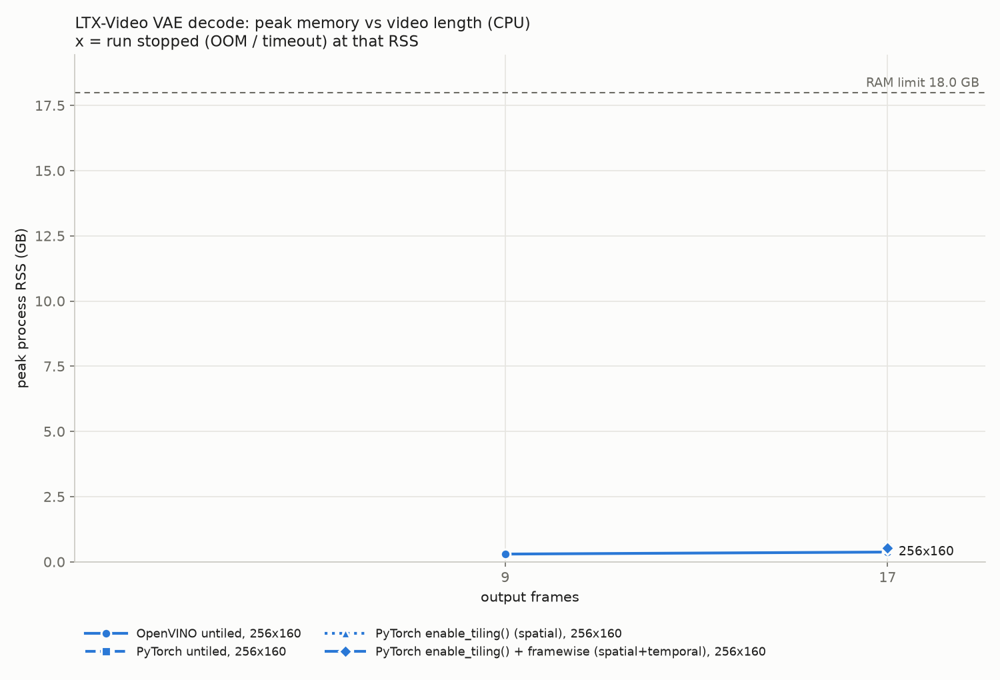

# Step 2 report: LTX-Video VAE decode memory vs video length (SMOKE TEST, tiny shapes)

Generated by `s2_memory_bench.py` on 2026-11-11 19:23:23; total runtime 0.4 min. Every number below was measured in this run (raw: `s2_results.csv/json`).

**This is a local smoke test of the code path. Its numbers say nothing about the real problem.**

## Setup
- Machine: arm, 12 logical CPUs, RAM limit 18.0 GB, swap 4.0 GB. Full details: `s2_env.txt`.
- Versions: python 3.13.7, openvino 2026.5.1.dev20261111, openvino-genai 2026.5.1.0.dev20261111, torch 2.15.0, diffusers 0.39.0, numpy 2.4.6, psutil 7.2.2, pandas 3.1.1, matplotlib 3.11.2.
- Model: TINY RANDOM-WEIGHT VAE of the same architecture (smoke test only), decoder converted to OpenVINO IR (FP32, dynamic frames/H/W), every Conv3d rewritten as Conv2d (`--conv3d-as-2d`, ARM workaround).
- Conversion: 2.89 s, peak RSS 0.94 GB, IR weights 0.01 GB, signature `[1,128,?,?,?]` -> `[1,3,?,?,?]`.
- IR check on latents [1, 128, 2, 4, 6]: output [1, 3, 9, 128, 192], max abs diff vs PyTorch 1.723e-05. 45 Convolution layers ran with exec type(s) ['gemm_acl_f32', 'winograd_acl_f32'] (OpenVINO CPU: Apple M3 Pro; inference precision <Type: 'float32'>).

## Method
- Each config runs in a fresh subprocess: load/compile the decoder, then ONE decode of random latents (random normal x real per-channel `latents_std` + `latents_mean`). Decode memory and time depend on the tensor shapes, not on the latent values: the decoder runs the same convolutions on the same shapes for any input.
- Peak RSS = max of the child's RSS sampled every 50 ms and (Linux) the kernel high-water mark VmHWM. It includes the runtime, the weights and the decoded output tensor.
- `OOM` = kernel SIGKILL, an allocation error, or the watchdog stopping the child when its RSS passed 3.7 GB (default: RAM limit - 1.5 GB) or system available memory fell under 1.0 GB. For OOM / timeout rows the RSS shown is where the run was stopped, a lower bound on what it needed.
- `timeout` = still running after 2 min. After the first OOM / timeout in a series, longer videos are `skipped`. `skipped` also covers configs dropped by the 0.1 h budget (see `detail` in the CSV).
- Latent frames = (frames - 1) / 8 + 1; latent H, W = H / 32, W / 32.

## OpenVINO, untiled decode
Cell = peak RSS / decode time.

| output frames | latent frames | OpenVINO untiled, 256x160 |
|---|---|---|
| 9 | 2 | 0.30 GB / 0.1 s |
| 17 | 3 | 0.37 GB / 0.1 s |

## Reference: diffusers PyTorch, untiled vs tiled
Cell = peak RSS / decode time.

| output frames | latent frames | OpenVINO untiled, 256x160 | PyTorch untiled, 256x160 | PyTorch enable_tiling() (spatial), 256x160 | PyTorch enable_tiling() + framewise (spatial+temporal), 256x160 |
|---|---|---|---|---|---|
| 9 | 2 | 0.30 GB / 0.1 s | - | - | - |
| 17 | 3 | 0.37 GB / 0.1 s | 0.57 GB / 0.1 s | 0.54 GB / 0.1 s | 0.54 GB / 0.3 s |

## What the numbers say

- **OpenVINO untiled, 256x160**: longest video decoded: 17 frames at 0.37 GB peak, 0.1 s; from 9 to 17 frames peak RSS went 0.30 -> 0.37 GB (1.3x), 0.08 GB per 8 extra frames on average. No failure in the tested range.
- **PyTorch untiled, 256x160**: longest video decoded: 17 frames at 0.57 GB peak, 0.1 s. No failure in the tested range.
- **PyTorch enable_tiling() (spatial), 256x160**: longest video decoded: 17 frames at 0.54 GB peak, 0.1 s. No failure in the tested range.
- **PyTorch enable_tiling() + framewise (spatial+temporal), 256x160**: longest video decoded: 17 frames at 0.54 GB peak, 0.3 s. No failure in the tested range.
- Tiling (spatial) at 256x160, 17 frames: peak RSS 0.57 -> 0.54 GB (-6%), decode 0.1 -> 0.1 s.
- Tiling (spatial+temporal) at 256x160, 17 frames: peak RSS 0.57 -> 0.54 GB (-6%), decode 0.1 -> 0.3 s.

## Notes
- Single run per config, no repeats: treat times as indicative, memory as the result.
- PyTorch runs load only the decoder half of the diffusers VAE, so both backends hold the same model.
- diffusers `enable_tiling()` only turns on spatial tiles; temporal tiling is the separate `use_framewise_decoding` flag, so both variants were measured.
- The OpenVINO runs decode in one shot, as a plain compiled decoder IR does. Whether OpenVINO GenAI's own pipeline adds any tiling was not tested in this step.
- Output shape check: all completed runs returned [1, 3, frames, H, W].
- Peak swap growth during any run: 0.00 GB.

